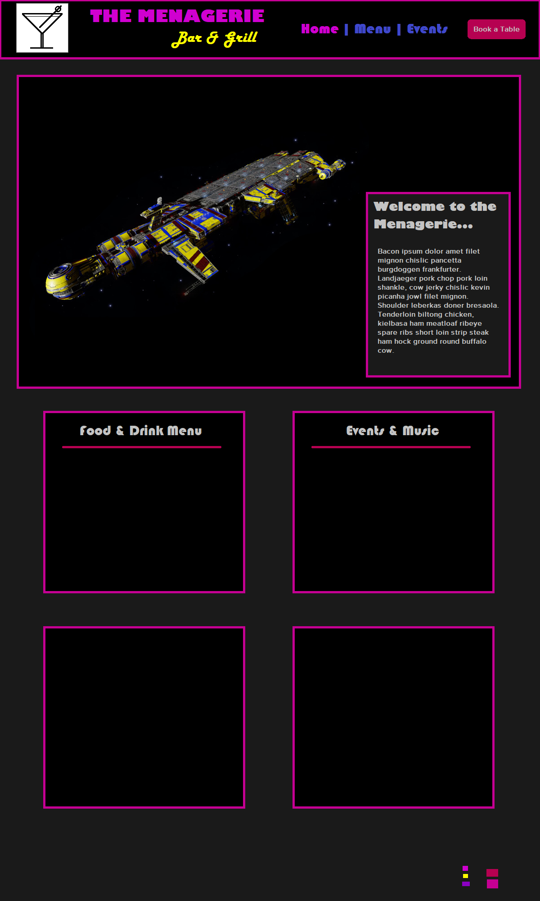
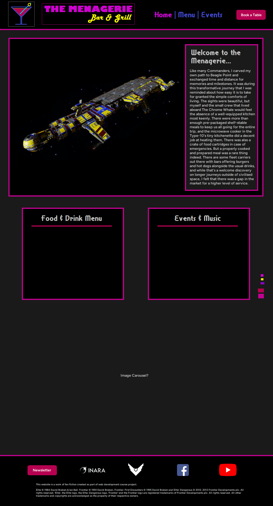
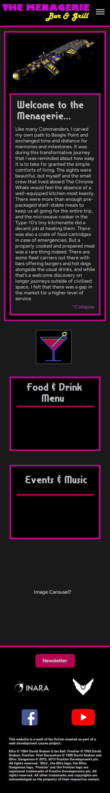

# mp1-menagerie-bar-and-grill
A website for a fictional dining establishment within the Elite Dangerous universe

---

# Menagerie Bar & Grill

Welcome to the **Menagerie Bar & Grill** - your hottest new dining destination.
Our restaurant aims to serve a wide range of tasty, crowd-pleasing meals made with quality ingredients and diverse techniques, all in a casual atmosphere with handcrafted cocktails and a broad choice of beers, wines and spirits. Our rotating schedule of live events will create the perfect setting for any occasion.

This website was designed to give guests a taste of what we offer, from browsing our menu to reserving a table for a special night out.

---

## Explore the Website

### Home

* Get a first impression of the Menagerie with bold imagery and a warm welcome.
* Learn what makes us unique as both a bar and a restaurant.

### Menu

* Browse our carefully selected food and drink menus.
* Discover chef’s specials and festive offerings.

### Events & Booking

* Stay informed about upcoming events, such as live DJs, quiz nights, and themed parties.
* Reserve a table through our simple booking form.

### Footer

* Find our location and opening hours.
* Connect with us on social media to keep up with the latest news.

---

## Why Visit Us Online?

* **Plan your night out** by checking our weekly events.
* **Browse our menu** before you arrive, so you already know your new favourite dish.
* **Reserve your spot** quickly with our booking form.
* **Stay connected** through social media links and contact information.

---

## Technologies Behind the Website

* **HTML5 & CSS3** - To create a modern, responsive design.
* **Bootstrap 5** - For layout, styling, and mobile-first responsiveness.
* **GitHub Pages** - Hosting the live site.

---

## Rationale

This project is for a fictional dining establishment set in a video game for role-playing purposes. For maximum authenticity and immersion I have presented the site largely as if it were for a real restaurant. The User Stories are intended to reflect this purpose.

---

## User Stories

### **User Story 1**
As a Customer, I want an easy-to-use navigation menu, so I can move between pages and sections without confusion.

**Acceptance Criteria**

- Navigation bar is visible on all pages.
- Navigation links correctly scroll to sections or move to different pages.
- Navbar is responsive: collapses into a toggleable menu on mobile devices.

**Tasks**

- Implement Bootstrap navbar across all pages.
- Ensure nav links use semantic <a> with descriptive aria-labels.
- Test responsiveness on mobile and tablet screen sizes.

### **User Story 2**
As a First-Time Visitor, I want to see strong visuals and a welcoming headline, so I immediately understand the restaurant’s style and atmosphere.

**Acceptance Criteria**

- Hero section includes a background image and welcome message.
- Hero section displays correctly on desktop, tablet, and mobile.

**Tasks**

- Add hero image with overlay text.
- Style hero section for responsive layouts.
- Validate accessibility (alt text, contrast).

## User Story 3
As a Customer, I want to view the restaurant’s menu, so I can see what’s available before visiting.

**Acceptance Criteria**

- Menu page displays clear categories (e.g., Starters, Mains, Desserts, Drinks).
- Menu items include dish name, description, and price.
- Layout is responsive and readable on smaller screens.

**Tasks**

- Create structured HTML with headings for categories.
- Style using Bootstrap grid or cards.
- Ensure text remains legible at 320px viewport.

## User Story 4:
As a Customer, I want to check upcoming events and easily reserve a table, so I can plan my night out.

**Acceptance Criteria**

- Events section lists at least 3 recurring or special events.
- Booking form contains fields for: Name, Email, Phone, Date, and Message.
- Form uses HTML validation (all required fields must be filled).
- Form redirects to a success/confirmation message.

**Tasks**

- Implement events list in structured HTML.
- Create form using Bootstrap form classes.
- Add required attributes for validation.
- Add simple success page.

## User Story 5:
As a Customer, I want to find opening hours, location, and social media links, so I can easily get in touch or follow the restaurant online.

**Acceptance Criteria**

- Footer visible on all pages.
- Includes opening hours, address, and contact email/phone.
- Contains links to at least 2 social media profiles.

**Tasks**

- Create footer with semantic `<footer>` element.
- Add placeholder social icons (e.g., Font Awesome).
- Style footer for readability.

## User Story 6:
As a Customer, I want to clearly see applicable discounts and offers, so I know when I can save money.

**Acceptance Criteria**

- Discount offers (e.g., Power, Squadron, frequent customer) highlighted visually.
- Offer text is readable on desktop and mobile.

**Tasks**

- Style special offers with distinctive background colour.
- Ensure contrast meets accessibility standards.

## User Story 7:
As a Regular Customer, I want to sign up for newsletters and updates, so I can stay informed about special offers, new games, and upcoming events.

**Acceptance Criteria**

- Signup form is visible in the footer.
- Form includes email input with validation.
- Displays a success message when submitted.

**Tasks**

- Add email input field in footer.
- Validate email format with HTML5.
- Create success page or inline confirmation.

---

## Wireframes

### Initial draft for the index.html

### Final draft wireframe for desktop

### Final draft wirefram for mobile

---

## Visit the Site

[Live Website](https://stevenwilliams604.github.io/mp1-menagerie-bar-and-grill/)

---

### Sources and acknowledgments

* Snappy Service font downloaded from https://www.1001fonts.com/snappyservice-font.html
* Screenshots from the Elite Dangerous video game by Frontier Developments
* Additional stock imagery from pexels.com and pixabay.com

---

## Looking Ahead

We’re always aiming to improve. Future versions of the site may include:

* Online ordering for takeaway and delivery.
* A gallery showcasing our dishes, cocktails, and events.
* Customer reviews and testimonials.

---

✨ *The Menagerie Bar & Grill is a fictional establishment, created as part of a web development course project.*
